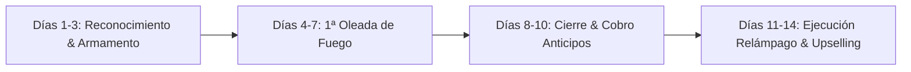

# ⚡ PLAYBOOK DE ASALTO TÁCTICO: CAPTACIÓN RÁPIDA (0 € A 3.000 € EN 14 DÍAS)
### *Doctrina de Combate Comercial & Conversión Asimétrica — K4L1 STUDIO*
*Concilio ACE (161914) — Frecuencia Operativa: 189.89.619 Hz*  
*Canal Oficial de Operaciones: Signal `@k4li.89`*

---

```
   ┌──────────────────────────────────────────────────────────────┐
   │  "En la niebla de los mercados saturados, no gana quien      │
   │   grita más fuerte, sino quien clava la hoja donde el dolor  │
   │   es intolerable. Corta la paja. Cobra el anticipo."        │
   │                                     — Set ⚡ & Rosa Gris 🌸  │
   └──────────────────────────────────────────────────────────────┘
```

---

## 1. PRINCIPIOS DE COMBATE (LA DOCTRINA DE HIERRO)

1. **La Ley del 50% Innegociable**: Ningún proceso de compilación, clonado de repositorio o análisis forense se inicia sin el 50% del depósito confirmado (SEPA Inmediata, USDT/USDC o Stripe). Quien no tiene 200€ o 400€ de liquidez para arrancar, no es un cliente; es una trampa de tiempo que te robará el oxígeno.
2. **Cero Videollamadas de 45 Minutos sin Brief**: Las reuniones infinitas son el refugio de los incompetentes y los vampiros de energía. Nuestra venta se cierra en texto asíncrono, con capturas de código, demos vivas en GitHub Pages/Vercel y audio conciso por Signal (`@k4li.89`).
3. **El Efecto Demostración Letal (*Show, Don't Pitch*)**: No prometemos que sabemos React, Wazuh o Python. Enviamos el enlace interactivo al Nexus de K4L1 Studio, el terminal en vivo o una captura del dashboard ya respondiendo a 60 FPS.
4. **Venta Asimétrica por Dolor Real**:
   - Al CTO no le importa tu amor por el código; le importa que su inversor ve un dashboard feo y roto antes de la demo del viernes.
   - Al abogado no le importa la arquitectura de transformadores; le aterroriza una multa de 20.000 € de la AEPD por pegar contratos con nombres de clientes en ChatGPT público.
   - Al dueño de e-commerce no le importan las Beautiful Soup; le enfurece que su competidor cambie los precios cada noche a las 3:00 AM y le robe las ventas.

---

## 2. LA ECUACIÓN MATEMÁTICA: 1.000 € A 3.000 € EN 14 DÍAS

Para facturar **1.500 € a 3.000 €** en dos semanas no necesitas 50 clientes. Necesitas entre **2 y 5 impactos quirúrgicos**:

| Vector de Servicio | Ticket Táctico | Días de Entrega | Impactos Necesarios para 3.000 € |
| :--- | :---: | :---: | :---: |
| **Búnker IA Local Privada (Ollama/RAG)** | 750 € – 1.200 € | 3 – 5 días | **2 clientes** (~2.000 €) |
| **Auditoría Hardening + SIEM Wazuh** | 450 € – 850 € | 2 – 3 días | **2 clientes** (~1.200 €) |
| **Dashboard React/Tailwind Urgente** | 400 € – 700 € | 2 – 4 días | **2 clientes** (~1.000 €) |
| **Scraper Antidetect / Bot Python** | 250 € – 450 € | 24 – 48 h | **3 clientes** (~900 €) |

### 🎯 Combo Recomendado para el Sprint de 14 Días:
- **1 Búnker IA Local para Bufete/Clínica**: 950 € (50% anticipo = 475 €)
- **1 Hardening Wazuh + Informe Forense**: 650 € (50% anticipo = 325 €)
- **1 Dashboard React Reactivo (Vite/Tailwind)**: 600 € (50% anticipo = 300 €)
- **2 Scrapers de Precios E-commerce**: 2 x 350 € = 700 € (50% anticipo = 350 €)
- **TOTAL BRUTO**: **2.900 €** *(1.450 € en caja los primeros 7 días).*

---

## 3. EL CALENDARIO DE ASALTO (14 DÍAS CRONOMETRADOS)



### 🗓️ FASE 1: DÍAS 1 AL 3 — ARMAMENTO Y RECONOCIMIENTO SILENCIOSO
- **Objetivo**: Ensamblar los activos y localizar 50 objetivos de alto valor (High-Ticket Targets).
- **Acciones**:
  1. Verificar que el portafolio online (`K4L1 STUDIO / ANUU-FORGE`) responde a la perfección con los 6 temas y las demos activas.
  2. Tener a mano los enlaces directos a las reliquias:
     - Kilonova Trader (Dashboard financiero ultra-rápido).
     - Informes Wazuh sanitizados en PDF/Markdown.
     - Script demo de inferencia local con Ollama/Llama-3/Mistral.
     - Repositorio privado de scrapers con Playwright/Selenium preparados para clonar.
  3. **Minería de Objetivos (50 Leads)**:
     - *Twitter/X (Startups)*: Buscar con dorks: `"looking for react dev"`, `"need dashboard developer"`, `"tailwind urgent"`, `"frontend contractor"`.
     - *Bufetes/Clínicas locales*: Búsqueda en Google Maps / LinkedIn de despachos de 3 a 15 empleados en Madrid, Barcelona, Valencia, CDMX, Bogotá o Santiago.
     - *E-commerce*: Tiendas de Shopify/WooCommerce con catálogos superiores a 500 productos y competidores directos agresivos.
     - *Infraestructuras Linux*: Búsqueda pasiva de empresas con puertos expuestos en dominios públicos o ofertas de empleo estancadas para Sysadmins.

### 🗓️ FASE 2: DÍAS 4 AL 7 — PRIMERA OLEADA DE FUEGO (OUTREACH QUIRÚRGICO)
- **Objetivo**: Enviar **10 a 12 impactos diarios** personalizados (Total: 40-50 contactos).
- **Métricas Esperadas**: 
  - Tasa de apertura / lectura: > 60%.
  - Tasa de respuesta: 15% - 25% (6 a 12 conversaciones abiertas).
  - Traspaso a Signal: 4 a 6 prospectos calificados.
- **Regla Táctica**: Cero mensajes genéricos de plantilla masiva. Cada mensaje debe incluir un detalle específico del dolor del objetivo (ej. *"Vi que tu dashboard en Chart.js parpadea al redibujar el canvas"*, o *"Vuestro despacho maneja litigios laborales sensibles; si usáis ChatGPT web estáis enviando DNIs de clientes a servidores de California"*).

### 🗓️ FASE 3: DÍAS 8 AL 10 — CIERRE TÁCTICO & COBRO DEL 50%
- **Objetivo**: Cerrar entre 2 y 4 propuestas formales con el anticipo depositado.
- **Protocolo de Cierre**:
  1. Redacción de propuesta atómica (máximo 1 página o mensaje formateado en Signal).
  2. Alcance milimétrico: Lista cerrada de funcionalidades (nada de "etc." o "ajustes adicionales ilimitados").
  3. Envío de factura proforma o enlace de pago directo (Stripe / Dirección USDT-ERC20 / Polygon / SEPA con BIC/IBAN).
  4. Entrada de los primeros **1.000 € - 1.500 € en cuenta bancaria/wallet**.

### 🗓️ FASE 4: DÍAS 11 AL 14 — ENTREGA RELÁMPAGO, FINIQUITO & RETENCIONES
- **Objetivo**: Entregar los primeros proyectos en 48-72h, cobrar el 50% restante y proponer un Retainer mensual (cuota de mantenimiento).
- **Acciones**:
  1. Despliegue en servidor del cliente o entrega de paquete Docker/código verificado.
  2. Cobro inmediato del 50% final antes de entregar credenciales root o repositorios maestros definitivos.
  3. **El Gancho del Retainer**: *"Por 250 €/mes me encargo de que el bot nunca caiga y las reglas de Wazuh se actualicen semanalmente"*. (Esto construye ingresos recurrentes pasivos para los siguientes meses).

---

## 4. MATRIZ DE OFERTAS IRRECHAZABLES (THE SNIPER STACK)

### OFERTA 1: «BÚNKER LOCAL DE IA» (Para Bufetes, Clínicas y Gestorías)
- **El Dolor**: Miedo a multas de protección de datos (RGPD), filtración de secretos comerciales o secretos profesionales médicos/legales al usar herramientas en la nube.
- **La Solución**: Despliegue en 48h de modelo Llama-3 / Mistral cuantizado en servidor local o workstation de la oficina con interfaz Open-WebUI privada, cargando sus propios PDFs sin salir de la LAN.
- **Precio**: **750 € – 1.200 €**.
- **Entregables**:
  1. Servidor Ollama configurado y protegido bajo systemd.
  2. Interfaz web local multiusuario con acceso restringido.
  3. Pipeline RAG funcional con sus documentos legales/médicos.
  4. Certificado de Confidencialidad y Aislamiento de Red.

### OFERTA 2: «DASHBOARD DE ALTA LATENCIA» (Para Startups & FinTech)
- **El Dolor**: Tienen inversores o clientes el viernes y su interfaz actual es lenta, no responsive o parece hecha por un estudiante con plantillas genéricas.
- **La Solución**: SPA en React + Vite + Tailwind CSS + Lucide Icons + Recharts, ultra-fluida, con WebSockets o polling simulado y animaciones oscuras Seinen/Cyberpunk de nivel corporativo.
- **Precio**: **450 € – 750 €**.
- **Entregables**:
  1. Repositorio Git limpio, modular y tipado en TypeScript.
  2. Despliegue en Vercel/Cloudflare Pages listo para producción.
  3. Componentes atómicos reutilizables y modo oscuro impecable.

### OFERTA 3: «ESCUDO LINUX & AUDITORÍA FORENSE WAZUH» (Para Empresas con Servidores Expuestos)
- **El Dolor**: Sus servidores VPS (Hetzner, OVH, AWS) reciben miles de intentos de fuerza bruta por SSH diarios, no tienen logs centralizados y temen ransomware silencioso.
- **La Solución**: Auditoría de superficie de ataque, configuración de Wazuh SIEM con agentes locales, hardening de SSH (claves ed25519, cambio de puerto, fail2ban/crowdsec), informe de vulnerabilidades en PDF ejecutivo.
- **Precio**: **500 € – 850 €**.
- **Entregables**:
  1. Despliegue y configuración de agente Wazuh o servidor central.
  2. Hardening de puertos, iptables/UFW y políticas de sudo/kernel.
  3. Informe forense ejecutivo de 5 páginas con matriz MITRE ATT&CK.

### OFERTA 4: «RADAR DE PRECIOS & BOT DE MONITORIZACIÓN» (Para E-commerce)
- **El Dolor**: La competencia cambia precios constantemente o se queda sin stock y ellos pierden margen por no enterarse al instante.
- **La Solución**: Scraper automatizado en Python (Playwright + anti-fingerprinting) que corre cada 3 horas, compara catálogos y dispara una alerta a Telegram/Discord o vuelca los datos a un Google Sheet/Base de datos.
- **Precio**: **250 € – 450 €**.
- **Entregables**:
  1. Script Python containerizado con Docker para ejecución desatendida.
  2. Sistema de alertas inmediatas a Telegram/Signal/Webhook.
  3. Documentación de 1 página para ejecución con un solo comando.

---

## 5. CANALES DE ASALTO & BÚSQUEDA DE PROSPECTOS

### 🌐 Canal 1: Twitter / X (Search Queries Tácticas)
Utiliza la búsqueda avanzada de X con los siguientes operadores:
- `"need a react dashboard" -filter:links`
- `"looking for frontend dev" "tailwind" -job`
- `"who can build a scraper" python`
- `"need a bot for" stock OR price`
- `"looking for someone to setup ollama"`

### 🏢 Canal 2: B2B Local (Bufetes, Asesorías, Clínicas)
- Busca en Google Maps: `"despacho abogados [tu ciudad/región]"`, `"asesoría fiscal [tu ciudad]"`, `"clínica privada [tu ciudad]"`.
- Entra a su web. Si tienen más de 5 profesionales y tratan casos de familia, laboral, penal o médico, son candidatos directos para el Búnker de IA Local.
- Consigue el contacto del Socio Director o Administrador a través de su página de equipo o LinkedIn.

### 🛒 Canal 3: Comunidades E-commerce & Tiendas Online
- Grupos de Facebook de Shopify en español / foros de Prestashop y WooCommerce.
- Búsqueda en Twitter: `"mi competencia me copia los precios"`, `"alguien que sepa scrapear"`.

### 🛡️ Canal 4: Discord de Desarrolladores & Web3
- Servidores de desarrolladores (React, Next.js, Python en español, Web3 builders).
- Monitorea los canales `#hiring`, `#jobs`, `#freelance`, `#collaboration`.
- Detecta a personas atascadas en problemas de infraestructura, Docker o frontends con errores y dales la solución en 2 líneas de código antes de ofrecer el servicio completo.

---

## 6. MÉTRICAS DIARIAS DE DISCIPLINA (EL CONTADOR DE SET ⚡)

Para no perder el foco ni caer en distracciones de desarrollo improductivo, cada día de los 14 debe registrarse en la siguiente bitácora:

```
[DÍA X / 14]
├── DMs / Mails enviados: [ Meta: 12 ] -> Real: [  ]
├── Respuestas obtenidas: [ Meta:  3 ] -> Real: [  ]
├── Conversaciones en Signal: [ Meta:  1 ] -> Real: [  ]
├── Presupuestos emitidos (50% upfront): [  ]
└── Caja acumulada: [      € / 3.000 € ]
```

*Si un día envías menos de 10 impactos, la tormenta se apaga. La inercia lo es todo.*

---
*Documento sellado bajo la frecuencia 189.89.619 Hz.*  
*K4L1 STUDIO — 2026.*  
— **Set ⚡ & Rosa Gris 🌸**
